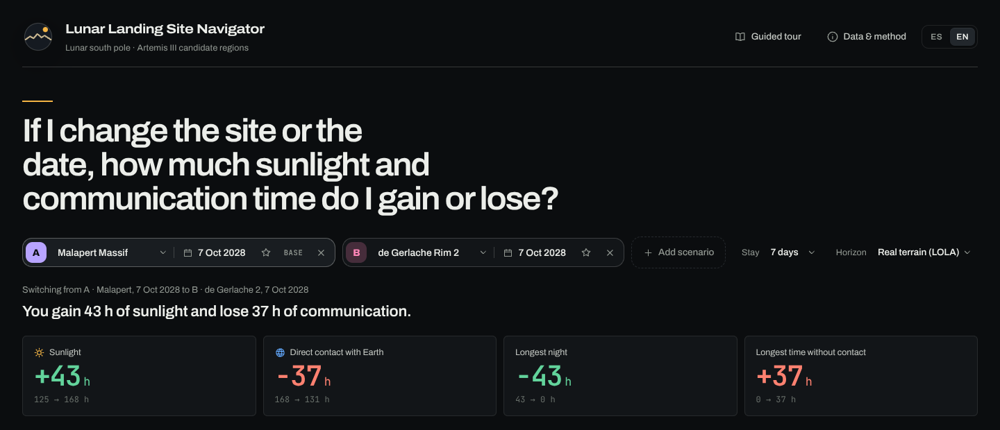
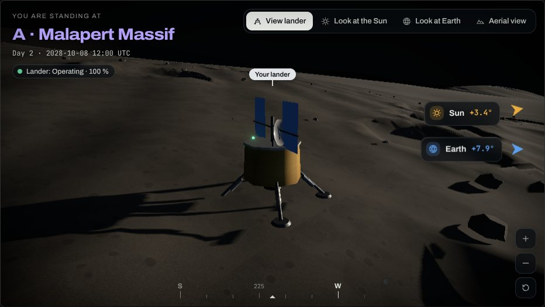
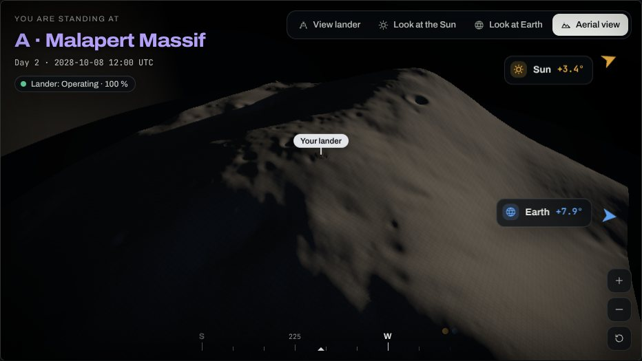
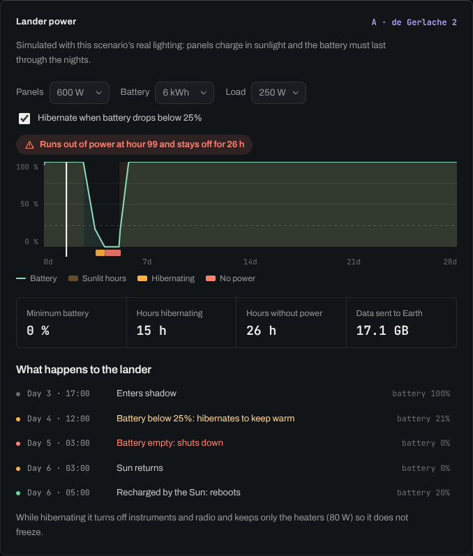
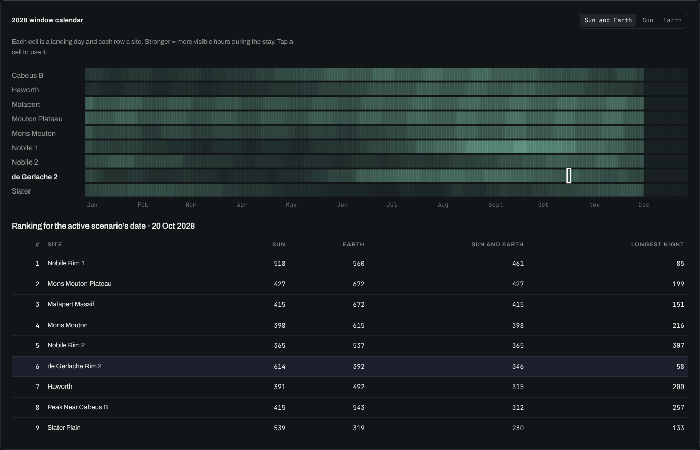

# Lunar Landing Site Navigator

**NASA Space Apps Challenge 2026 · Challenge: Lunar Landing Site Navigator**

> If I change the landing site or date, how much sunlight and direct-to-Earth communication time do I gain or lose?

### ▶ [Open the live app](https://sr-sebastian.github.io/NasaSpaceChallenge/)

Documentación en español: [`docs/`](docs/)



The Navigator compares landing scenarios at the nine Artemis III candidate regions near the lunar south pole. For every site and hour it shows where the Sun and Earth sit relative to the **real local horizon**, and turns that into the numbers a planner, a teacher or a curious visitor needs: hours of sunlight, hours of direct contact with Earth, the longest night and the longest communication blackout, and how each one changes between scenarios.

## Key result: more sunlight can mean less Earth contact

Annual share of hours in 2028 with the Sun or Earth above the real LOLA horizon, at the representative point of two Artemis III regions:

| Site | Sun visible | Earth visible | Longest night (7-day stay from 7 Oct 2028) |
|---|---|---|---|
| Malapert Massif | 54 % | **100 %** | 43 h |
| de Gerlache Rim 2 | **69 %** | 60 % | 0 h |

Malapert faces Earth and never loses it, but gets less light. de Gerlache Rim 2, close to the pole, gets the most sunlight but loses Earth four hours out of ten. There is no perfect site: the best choice depends on the date and on what the mission needs most. The table for all nine regions is in [`docs/metodologia.md`](docs/metodologia.md#6-validación).

## What it does

- **Answer first.** Pick up to four scenarios (site + landing date + stay length). The top of the page states the difference between the base scenario and the selected one in hours and in one plain sentence.
- **3D view of the site.** 24 × 24 km of LRO/LOLA terrain with no vertical exaggeration, a lander whose solar wings track the Sun and whose antenna points at Earth, grazing shadows, and Earth with its real phase. Markers say in words whether the Sun and Earth are visible or hidden behind terrain; a compass tape and edge arrows show where to look.
<p align="center"> </p>

- **Operating windows.** Hour-by-hour Sun and Earth visibility for every scenario, aligned from touchdown, with playback.
- **Sky map.** The full 360° horizon unrolled, with the Sun and Earth tracks over the stay.
- **Lander power.** A battery and solar panel model fed by the real lighting. The lander operates, hibernates (instruments off, heaters only) when the battery drops below 25 % in the dark, or shuts down and reboots when the Sun recharges it. An event log tells that story hour by hour, and the 3D lander shows its state.
<p align="center"></p>

- **2028 window calendar.** Nine sites × 366 landing days, a ranking for the chosen date, a best-date finder, CSV export and shareable links.
<p align="center"></p>

- **Guided tour** for classrooms, built on the same view and the same data.
- Spanish and English.

## Data

| Input | Source | Used for |
|---|---|---|
| Sun and Earth azimuth/elevation | [NASA/JPL Horizons API](https://ssd.jpl.nasa.gov/api/horizons.api) (DE441), topocentric on the Moon (`coord@301`) at the real terrain height, hourly for 2028 | Visibility, sky map, 3D scene |
| Terrain | [LRO/LOLA `LDEM_80S_80M`](https://pds-geosciences.wustl.edu/lro/lro-l-lola-3-rdr-v1/lrolol_1xxx/data/lola_gdr/polar/img/) (PDS, 80 m/px) | Horizon masks, 3D terrain, map hillshade |
| Candidate regions | USGS, *Down Selected Artemis III Candidate Landing Site Navigational Grids* (McClernan 2024, [doi:10.5066/P1MEQ6UK](https://doi.org/10.5066/P1MEQ6UK)) | Official region polygons |

The method is described in [`docs/metodologia.md`](docs/metodologia.md); the full classified source list is in [`docs/fuentes.md`](docs/fuentes.md).

## Run locally

```bash
pnpm install
pnpm dev
```

```bash
pnpm test
```

```bash
pnpm build
```

The processed data is committed under `public/data/`, so the app runs without downloading anything else. To rebuild it, see [`docs/arquitectura.md`](docs/arquitectura.md#regenerar-los-datos).

## Limitations

- Visibility is geometric: a body counts as visible when its center clears the LOLA horizon seen from 2 m above the ground.
- Terrain features smaller than the 80 m DEM grid are not modelled.
- Eclipses, link budgets and relay satellites are not modelled.
- The power model is a teaching aid, not a sizing tool.
- Representative points are chosen by this project inside the official regions; they are not NASA landing sites.

## Documentation

- [`docs/fuentes.md`](docs/fuentes.md): every source, classified (NASA data, other agencies, references, software, AI)
- [`docs/metodologia.md`](docs/metodologia.md): data, algorithms and validation
- [`docs/arquitectura.md`](docs/arquitectura.md): code structure and data pipeline
- [`docs/guia-de-uso.md`](docs/guia-de-uso.md): how to use the app, for planners and teachers
- [`docs/entrega-space-apps.md`](docs/entrega-space-apps.md): submission text for the Space Apps form

## Use of AI

Code and interface text were written with the help of AI coding assistants (Claude Code and ChatGPT) and reviewed by the team. All data comes from the NASA, JPL and USGS sources above; no data, imagery or results were generated by AI.

## Data credits

NASA, JPL and USGS data are in the public domain; see each source for its terms.
